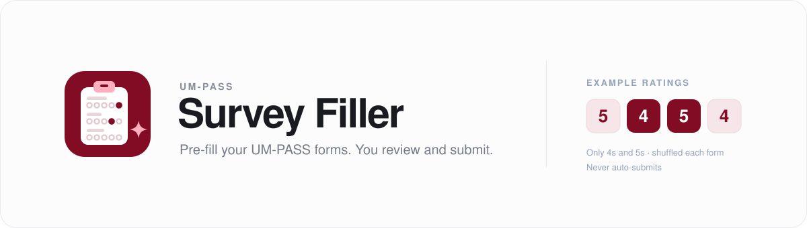

  

<h1 align="center">UM-PASS Survey Filler</h1>

A local-only Chrome and Edge extension that fills supported <a href="https://umpass.umindanao.edu.ph/feedback-form/">UM-PASS</a> surveys and evaluations. Its Start button scans available entries across the three feedback sections, then sends and confirms each recognized form.

<code>Version 1.3.4</code> &nbsp; <code>Chrome · Edge · Manifest V3</code> &nbsp; <code>Vanilla JavaScript</code> &nbsp; <code>Runs locally</code>

  
   
  Load it unpacked in a few steps. Start sends answers only when the form and confirmation controls are recognized.

  <a href="#at-a-glance"><strong>At a glance</strong></a> &nbsp;·&nbsp;
  <a href="#install-or-update"><strong>Install</strong></a> &nbsp;·&nbsp;
  <a href="#supports"><strong>Supports</strong></a> &nbsp;·&nbsp;
  <a href="#important-limits"><strong>Important limits</strong></a>

## At a glance

<table>
  <tr>
    <td align="center" width="25%"><strong>01 · Fill</strong> Randomized 4/5 rating mix on five-point scales</td>
    <td align="center" width="25%"><strong>02 · Match</strong> Context-aware college and venue options</td>
    <td align="center" width="25%"><strong>03 · Comment</strong> Set comment and improvement fields to “None”</td>
    <td align="center" width="25%"><strong>04 · Send</strong> Start confirms recognized forms and moves to the next</td>
  </tr>
</table>

## Install or update

1. Download or clone this repository (or extract its release ZIP).
2. Open `chrome://extensions` (`edge://extensions` in Edge), and enable **Developer mode**.
3. If you previously installed the extension, click **Remove** on the old copy (or replace the contents of the original unpacked folder, then press **Reload**).
4. Click **Load unpacked** and select the extracted `um-pass-survey-filler` directory containing `manifest.json`.
5. Open any UM-PASS feedback section and click **Start all sections**. Keep the tab open while it scans Survey, Course, and Performance. The popup shows the fixed answers before you start: **CCE Data Communication Laboratory** and **None** for comments. Reopen the extension to see progress or click **Stop automation**.
6. For location preferences, auto-fill, manual filling, or section links, expand **Options and manual tools**. For manual use, open an individual form and click **Fill current form only**, then check the answers and submit it yourself.

If the popup cannot connect after an extension update, reload the unpacked extension and reopen the popup. Version 1.3.4 can inject its page script into an already open UM-PASS tab; if Brave blocks that, allow the extension to access `umpass.umindanao.edu.ph` and refresh the tab.

## Supports

- **Survey** (`/feedback-form/survey`) list and available individual forms.
- **Course Delivery Evaluation** (`/feedback-form/course-assessment`) list and 1–5 rating groups (37 question group layout verified against supplied HTML).
- **Performance Evaluation** (`/feedback-form/evaluation`) list and compatible individual forms.
- Automatic 4/5 randomized rating mix on detected five-point numeric / label rating scales; never assigns 1, 2, or 3.
- Skip already selected ratings; use the existing form UI's click events so reactive forms receive changes.
- **Smart location matching:** favor a laboratory for clearly lab-related venue questions and a gym for clearly sports-related venue questions, only if that option appears. College, campus, and uncertain locations are left blank for review. Select **Prefer CCE** to fill a college question with CCE when that option appears; other location settings can prefer Gym or skip location filling.
- Vuetify Laboratory dropdowns are set to **CCE Data Communication Laboratory**, including when another laboratory is preselected.
- Clearly designated comment and improvement text fields are set to **None**, including fields with existing text.
- **Start all sections** scans visible Answer Survey / Evaluation / Course Assessment buttons, fills an individual form, clicks Send Answer or Submit, confirms in a recognized dialog, and continues to the next available entry and section. It stops if a required answer, button, or result cannot be verified.
- The runner advances as soon as recognized controls appear and skips sections that already show only Completed or Locked entries.
- **Auto-fill** fills newly opened forms, sets comment or improvement fields to **None**, and selects **CCE Data Communication Laboratory** without submitting; **Fill current form only** does the same on the current form for manual review.
- Quick-access buttons for Survey, Course Delivery, and Performance sections.

## Important limits

The supplied HTML includes all three listing pages and a Laboratory Satisfaction Survey form before and during its submission dialog. That form shows 18 rating groups, a Laboratory dropdown, **Send Answers**, and **Confirm & Submit**. The dropdown's open menu, other individual form types, and the post-submission result have not been captured, so those paths remain unverified against the live site. The runner stops instead of guessing when it cannot recognize a required answer, button, or result. It skips disabled Locked and Completed entries. No hidden API calls or authentication handling are used. Smart mode leaves college, campus, and uncertain locations blank; choose **Prefer CCE** only if CCE is your real answer. The fixed laboratory and “None” responses replace existing answers in those fields. The randomized ratings should reflect your genuine evaluation before you use automatic submission.

All configuration remains in your browser's extension storage. No separate network requests. Not affiliated with UM.

## Checks

Run `node --test` to check rating grouping, location answer preservation, dropdown selection, and the simulated three-section runner. The tests use Node's built-in test runner and need no packages.
